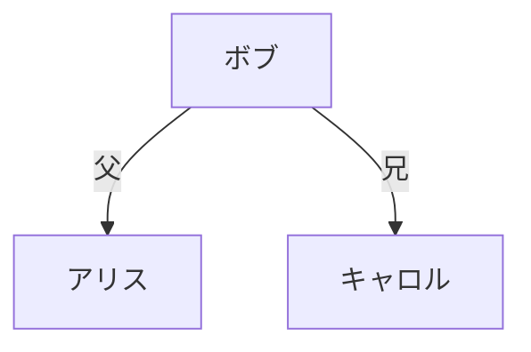

# siori（小説のしおり）Android アプリ 実装計画

> **For agentic workers:** REQUIRED SUB-SKILL: Use superpowers:subagent-driven-development (recommended) or superpowers:executing-plans to implement this plan task-by-task. Steps use checkbox (`- [ ]`) syntax for tracking.

**Goal:** 同梱の JSON 人物情報と Mermaid 関係図を、オフラインで検索・参照できる Android アプリを作る。

**Architecture:** 単一 `:app` モジュールの Jetpack Compose アプリ。`data` パッケージで同梱アセットを読み、`ui` パッケージの画面（作品一覧 → 人物一覧/検索 → 関係図）が Repository 経由で参照する。関係図は WebView + 同梱 mermaid.js で実行時描画する。

**Tech Stack:** Kotlin 2.0.21 / AGP 8.7.3 / Gradle 8.11.1 / JDK 21 / Jetpack Compose (Material 3) / navigation-compose / kotlinx.serialization / androidx.webkit。ビルドツールは mise 管理。

**Spec:** `docs/superpowers/specs/2026-10-12-siori-android-app-design.md`

## Global Constraints

- `applicationId = com.example.siori`、`namespace = com.example.siori`。
- `minSdk = 26` / `targetSdk = 35` / `compileSdk = 35`。
- Kotlin / Java / Gradle は mise 管理（`.mise.toml`）。JDK は temurin-21、Gradle は 8.11.1。
- DB を使わない。データは `app/src/main/assets/` 同梱のみ。
- `INTERNET` パーミッションを付与しない（完全オフライン）。
- 作品IDはディレクトリ名・`catalog.json.works[].id`・`characters.json.workId` で一致させる。
- 人物IDは作品内で一意。Mermaid の人物ノードIDは人物IDに一致。補助ノードIDは `aux:` プレフィックス必須。
- コメントは原則書かない（意図は命名と構造で示す）。
- 各タスクの完了時に `./gradlew test` と `./gradlew assembleDebug` が通る状態を保つ。

---

## ファイル構成

```
.mise.toml
.gitignore
gradle.properties
settings.gradle.kts
build.gradle.kts
gradle/libs.versions.toml
gradle/wrapper/gradle-wrapper.properties
gradlew, gradlew.bat, gradle/wrapper/gradle-wrapper.jar
local.properties                       (gitignore, sdk.dir)
app/build.gradle.kts
app/src/main/AndroidManifest.xml
app/src/main/res/values/strings.xml
app/src/main/assets/catalog.json
app/src/main/assets/works/sample-novel/characters.json
app/src/main/assets/works/sample-novel/relations.mmd
app/src/main/assets/mermaid/mermaid.min.js
app/src/main/assets/mermaid/viewer.html
app/src/main/java/com/example/siori/MainActivity.kt
app/src/main/java/com/example/siori/data/Catalog.kt            (Catalog, Work)
app/src/main/java/com/example/siori/data/Character.kt          (Character, CharactersFile)
app/src/main/java/com/example/siori/data/AssetTextSource.kt    (interface)
app/src/main/java/com/example/siori/data/AndroidAssetTextSource.kt
app/src/main/java/com/example/siori/data/AssetExceptions.kt
app/src/main/java/com/example/siori/data/SioriRepository.kt    (interface)
app/src/main/java/com/example/siori/data/AssetSioriRepository.kt
app/src/main/java/com/example/siori/data/AssetValidator.kt
app/src/main/java/com/example/siori/ui/UiState.kt
app/src/main/java/com/example/siori/ui/search/QueryNormalizer.kt
app/src/main/java/com/example/siori/ui/SioriViewModelFactory.kt
app/src/main/java/com/example/siori/ui/theme/Theme.kt
app/src/main/java/com/example/siori/ui/SioriApp.kt             (NavHost)
app/src/main/java/com/example/siori/ui/works/WorkListViewModel.kt
app/src/main/java/com/example/siori/ui/works/WorkListScreen.kt
app/src/main/java/com/example/siori/ui/characters/CharacterListViewModel.kt
app/src/main/java/com/example/siori/ui/characters/CharacterListScreen.kt
app/src/main/java/com/example/siori/ui/relations/RelationsViewModel.kt
app/src/main/java/com/example/siori/ui/relations/RelationsScreen.kt
app/src/main/java/com/example/siori/ui/relations/MermaidDiagram.kt
app/src/test/java/com/example/siori/data/SerializationTest.kt
app/src/test/java/com/example/siori/data/AssetSioriRepositoryTest.kt
app/src/test/java/com/example/siori/data/AssetValidatorTest.kt
app/src/test/java/com/example/siori/data/TestAssetTextSource.kt
app/src/test/java/com/example/siori/ui/search/QueryNormalizerTest.kt
```

---

## Task 1: プロジェクト雛形とデータモデル

**Files:**
- Create: `.mise.toml`, `.gitignore`, `gradle.properties`, `settings.gradle.kts`, `build.gradle.kts`, `gradle/libs.versions.toml`, `app/build.gradle.kts`, `app/src/main/AndroidManifest.xml`, `app/src/main/res/values/strings.xml`, `app/src/main/java/com/example/siori/MainActivity.kt`, `app/src/main/java/com/example/siori/ui/theme/Theme.kt`
- Create: `app/src/main/java/com/example/siori/data/Catalog.kt`, `app/src/main/java/com/example/siori/data/Character.kt`
- Test: `app/src/test/java/com/example/siori/data/SerializationTest.kt`

**Interfaces:**
- Consumes: なし
- Produces:
  - `@Serializable data class Work(val id: String, val title: String, val author: String)`
  - `@Serializable data class Catalog(val schemaVersion: Int, val works: List<Work>)`
  - `@Serializable data class Character(val id: String, val name: String, val aliases: List<String> = emptyList(), val description: String)`
  - `@Serializable data class CharactersFile(val schemaVersion: Int, val workId: String, val characters: List<Character>)`

- [ ] **Step 1: mise・Git・Gradle 設定ファイルを作成**

`.mise.toml`:

```toml
[tools]
java = "temurin-21.0.12+8.0.LTS"
gradle = "8.14.5"
```

`.gitignore`:

```
.gradle/
build/
local.properties
.idea/
*.iml
.kotlin/
captures/
```

`gradle.properties`:

```
org.gradle.jvmargs=-Xmx2048m -Dfile.encoding=UTF-8
android.useAndroidX=true
kotlin.code.style=official
android.nonTransitiveRClass=true
```

`settings.gradle.kts`:

```kotlin
pluginManagement {
    repositories {
        google {
            content {
                includeGroupByRegex("com\\.android.*")
                includeGroupByRegex("com\\.google.*")
                includeGroupByRegex("androidx.*")
            }
        }
        mavenCentral()
        gradlePluginPortal()
    }
}

dependencyResolutionManagement {
    repositoriesMode.set(RepositoriesMode.FAIL_ON_PROJECT_REPOS)
    repositories {
        google()
        mavenCentral()
    }
}

rootProject.name = "siori"
include(":app")
```

`build.gradle.kts`:

```kotlin
plugins {
    alias(libs.plugins.android.application) apply false
    alias(libs.plugins.kotlin.android) apply false
    alias(libs.plugins.kotlin.compose) apply false
    alias(libs.plugins.kotlin.serialization) apply false
}
```

`gradle/libs.versions.toml`:

```toml
[versions]
agp = "8.7.3"
kotlin = "2.0.21"
coreKtx = "1.13.1"
activityCompose = "1.9.3"
composeBom = "2024.10.01"
navigationCompose = "2.8.4"
lifecycle = "2.8.7"
webkit = "1.12.1"
serialization = "1.7.3"
junit = "4.13.2"

[libraries]
androidx-core-ktx = { group = "androidx.core", name = "core-ktx", version.ref = "coreKtx" }
androidx-activity-compose = { group = "androidx.activity", name = "activity-compose", version.ref = "activityCompose" }
androidx-compose-bom = { group = "androidx.compose", name = "compose-bom", version.ref = "composeBom" }
androidx-compose-ui = { group = "androidx.compose.ui", name = "ui" }
androidx-compose-ui-graphics = { group = "androidx.compose.ui", name = "ui-graphics" }
androidx-compose-ui-tooling = { group = "androidx.compose.ui", name = "ui-tooling" }
androidx-compose-ui-tooling-preview = { group = "androidx.compose.ui", name = "ui-tooling-preview" }
androidx-compose-material3 = { group = "androidx.compose.material3", name = "material3" }
androidx-compose-material-icons-extended = { group = "androidx.compose.material", name = "material-icons-extended" }
androidx-navigation-compose = { group = "androidx.navigation", name = "navigation-compose", version.ref = "navigationCompose" }
androidx-lifecycle-viewmodel-compose = { group = "androidx.lifecycle", name = "lifecycle-viewmodel-compose", version.ref = "lifecycle" }
androidx-lifecycle-runtime-compose = { group = "androidx.lifecycle", name = "lifecycle-runtime-compose", version.ref = "lifecycle" }
androidx-webkit = { group = "androidx.webkit", name = "webkit", version.ref = "webkit" }
kotlinx-serialization-json = { group = "org.jetbrains.kotlinx", name = "kotlinx-serialization-json", version.ref = "serialization" }
junit = { group = "junit", name = "junit", version.ref = "junit" }

[plugins]
android-application = { id = "com.android.application", version.ref = "agp" }
kotlin-android = { id = "org.jetbrains.kotlin.android", version.ref = "kotlin" }
kotlin-compose = { id = "org.jetbrains.kotlin.plugin.compose", version.ref = "kotlin" }
kotlin-serialization = { id = "org.jetbrains.kotlin.plugin.serialization", version.ref = "kotlin" }
```

`app/build.gradle.kts`:

```kotlin
plugins {
    alias(libs.plugins.android.application)
    alias(libs.plugins.kotlin.android)
    alias(libs.plugins.kotlin.compose)
    alias(libs.plugins.kotlin.serialization)
}

android {
    namespace = "com.example.siori"
    compileSdk = 35

    defaultConfig {
        applicationId = "com.example.siori"
        minSdk = 26
        targetSdk = 35
        versionCode = 1
        versionName = "0.1.0"
    }

    buildTypes {
        release {
            isMinifyEnabled = false
            proguardFiles(getDefaultProguardFile("proguard-android-optimize.txt"), "proguard-rules.pro")
        }
    }

    compileOptions {
        sourceCompatibility = JavaVersion.VERSION_17
        targetCompatibility = JavaVersion.VERSION_17
    }

    kotlinOptions {
        jvmTarget = "17"
    }

    buildFeatures {
        compose = true
    }
}

dependencies {
    implementation(libs.androidx.core.ktx)
    implementation(libs.androidx.activity.compose)
    implementation(platform(libs.androidx.compose.bom))
    implementation(libs.androidx.compose.ui)
    implementation(libs.androidx.compose.ui.graphics)
    implementation(libs.androidx.compose.ui.tooling.preview)
    implementation(libs.androidx.compose.material3)
    implementation(libs.androidx.compose.material.icons.extended)
    implementation(libs.androidx.navigation.compose)
    implementation(libs.androidx.lifecycle.viewmodel.compose)
    implementation(libs.androidx.lifecycle.runtime.compose)
    implementation(libs.androidx.webkit)
    implementation(libs.kotlinx.serialization.json)
    testImplementation(libs.junit)
}
```

`app/src/main/AndroidManifest.xml`:

```xml
<?xml version="1.0" encoding="utf-8"?>
<manifest xmlns:android="http://schemas.android.com/apk/res/android">

    <application
        android:allowBackup="true"
        android:label="@string/app_name"
        android:supportsRtl="true"
        android:theme="@android:style/Theme.Material.Light.NoActionBar">
        <activity
            android:name=".MainActivity"
            android:exported="true">
            <intent-filter>
                <action android:name="android.intent.action.MAIN" />
                <category android:name="android.intent.category.LAUNCHER" />
            </intent-filter>
        </activity>
    </application>

</manifest>
```

`app/src/main/res/values/strings.xml`:

```xml
<resources>
    <string name="app_name">しおり</string>
</resources>
```

- [ ] **Step 2: ツールをインストールし Gradle wrapper を生成**

Run:

```bash
mise trust
mise install
printf 'sdk.dir=/home/youknow/Android/Sdk\n' > local.properties
mise exec -- gradle wrapper --gradle-version 8.11.1 --distribution-type bin
```

Expected: `local.properties` と `gradlew` / `gradle/wrapper/gradle-wrapper.jar` が生成される。

- [ ] **Step 3: MainActivity とテーマの最小実装を作成**

`app/src/main/java/com/example/siori/MainActivity.kt`:

```kotlin
package com.example.siori

import android.os.Bundle
import androidx.activity.ComponentActivity
import androidx.activity.compose.setContent
import androidx.compose.material3.MaterialTheme
import androidx.compose.material3.Surface
import androidx.compose.material3.Text
import com.example.siori.ui.theme.SioriTheme

class MainActivity : ComponentActivity() {
    override fun onCreate(savedInstanceState: Bundle?) {
        super.onCreate(savedInstanceState)
        setContent {
            SioriTheme {
                Surface(color = MaterialTheme.colorScheme.background) {
                    Text("しおり")
                }
            }
        }
    }
}
```

`app/src/main/java/com/example/siori/ui/theme/Theme.kt`:

```kotlin
package com.example.siori.ui.theme

import androidx.compose.foundation.isSystemInDarkTheme
import androidx.compose.material3.MaterialTheme
import androidx.compose.material3.darkColorScheme
import androidx.compose.material3.lightColorScheme
import androidx.compose.runtime.Composable

@Composable
fun SioriTheme(
    darkTheme: Boolean = isSystemInDarkTheme(),
    content: @Composable () -> Unit,
) {
    val colorScheme = if (darkTheme) darkColorScheme() else lightColorScheme()
    MaterialTheme(colorScheme = colorScheme, content = content)
}
```

- [ ] **Step 4: ビルドが通ることを確認**

Run: `./gradlew assembleDebug`
Expected: `BUILD SUCCESSFUL`。

- [ ] **Step 5: データモデルの失敗テストを書く**

`app/src/test/java/com/example/siori/data/SerializationTest.kt`:

```kotlin
package com.example.siori.data

import kotlinx.serialization.json.Json
import org.junit.Assert.assertEquals
import org.junit.Test

class SerializationTest {
    private val json = Json { ignoreUnknownKeys = true }

    @Test
    fun parsesCatalog() {
        val text = """
            {"schemaVersion":1,"works":[{"id":"sample-novel","title":"作品名","author":"著者名"}]}
        """.trimIndent()
        val catalog = json.decodeFromString<Catalog>(text)
        assertEquals(1, catalog.schemaVersion)
        assertEquals("sample-novel", catalog.works.single().id)
        assertEquals("著者名", catalog.works.single().author)
    }

    @Test
    fun parsesCharactersWithDefaultAliases() {
        val text = """
            {"schemaVersion":1,"workId":"sample-novel","characters":[{"id":"alice","name":"アリス","description":"主人公。"}]}
        """.trimIndent()
        val file = json.decodeFromString<CharactersFile>(text)
        assertEquals("sample-novel", file.workId)
        assertEquals(emptyList<String>(), file.characters.single().aliases)
        assertEquals("主人公。", file.characters.single().description)
    }
}
```

- [ ] **Step 6: テストが失敗（コンパイルエラー）することを確認**

Run: `./gradlew testDebugUnitTest --tests "com.example.siori.data.SerializationTest"`
Expected: FAIL — `Unresolved reference: Catalog` などのコンパイルエラー。

- [ ] **Step 7: モデルを実装**

`app/src/main/java/com/example/siori/data/Catalog.kt`:

```kotlin
package com.example.siori.data

import kotlinx.serialization.Serializable

@Serializable
data class Work(
    val id: String,
    val title: String,
    val author: String,
)

@Serializable
data class Catalog(
    val schemaVersion: Int,
    val works: List<Work>,
)
```

`app/src/main/java/com/example/siori/data/Character.kt`:

```kotlin
package com.example.siori.data

import kotlinx.serialization.Serializable

@Serializable
data class Character(
    val id: String,
    val name: String,
    val aliases: List<String> = emptyList(),
    val description: String,
)

@Serializable
data class CharactersFile(
    val schemaVersion: Int,
    val workId: String,
    val characters: List<Character>,
)
```

- [ ] **Step 8: テストが通ることを確認**

Run: `./gradlew testDebugUnitTest --tests "com.example.siori.data.SerializationTest"`
Expected: PASS（2 tests）。

- [ ] **Step 9: コミット**

```bash
git add .mise.toml .gitignore gradle.properties settings.gradle.kts build.gradle.kts gradle app app/build.gradle.kts
git commit -m "chore: scaffold siori Android project with data models"
```

---

## Task 2: アセット読み込み層と Repository

**Files:**
- Create: `app/src/main/java/com/example/siori/data/AssetTextSource.kt`, `app/src/main/java/com/example/siori/data/AndroidAssetTextSource.kt`, `app/src/main/java/com/example/siori/data/AssetExceptions.kt`, `app/src/main/java/com/example/siori/data/SioriRepository.kt`, `app/src/main/java/com/example/siori/data/AssetSioriRepository.kt`
- Create: `app/src/main/assets/catalog.json`, `app/src/main/assets/works/sample-novel/characters.json`, `app/src/main/assets/works/sample-novel/relations.mmd`
- Test: `app/src/test/java/com/example/siori/data/TestAssetTextSource.kt`, `app/src/test/java/com/example/siori/data/AssetSioriRepositoryTest.kt`

**Interfaces:**
- Consumes: `Work`, `Catalog`, `Character`, `CharactersFile`（Task 1）
- Produces:
  - `interface AssetTextSource { fun readText(path: String): String; fun list(path: String): List<String> }`
  - `class AndroidAssetTextSource(assets: android.content.res.AssetManager) : AssetTextSource`
  - `class AssetMissingException(path: String) : Exception`
  - `class AssetParseException(path: String, cause: Throwable) : Exception`
  - `interface SioriRepository { suspend fun loadCatalog(): List<Work>; suspend fun loadCharacters(workId: String): List<Character>; suspend fun loadRelations(workId: String): String }`
  - `class AssetSioriRepository(source: AssetTextSource, json: Json = Json { ignoreUnknownKeys = true }, io: CoroutineDispatcher = Dispatchers.IO) : SioriRepository`

- [ ] **Step 1: 失敗テストを書く**

`app/src/test/java/com/example/siori/data/TestAssetTextSource.kt`:

```kotlin
package com.example.siori.data

class TestAssetTextSource(private val files: Map<String, String>) : AssetTextSource {
    override fun readText(path: String): String =
        files[path] ?: throw AssetMissingException(path)

    override fun list(path: String): List<String> =
        files.keys.filter { it.startsWith("$path/") }
            .map { it.removePrefix("$path/").substringBefore('/') }
            .distinct()
}
```

`app/src/test/java/com/example/siori/data/AssetSioriRepositoryTest.kt`:

```kotlin
package com.example.siori.data

import kotlinx.coroutines.Dispatchers
import kotlinx.coroutines.test.runTest
import org.junit.Assert.assertEquals
import org.junit.Test

class AssetSioriRepositoryTest {
    private val source = TestAssetTextSource(
        mapOf(
            "catalog.json" to """{"schemaVersion":1,"works":[{"id":"w1","title":"本","author":"著者"}]}""",
            "works/w1/characters.json" to """{"schemaVersion":1,"workId":"w1","characters":[{"id":"a","name":"A","description":"d"}]}""",
            "works/w1/relations.mmd" to "flowchart TD\n  a[\"A\"]",
        )
    )
    private val repo = AssetSioriRepository(source, io = Dispatchers.Unconfined)

    @Test
    fun loadsCatalog() = runTest {
        assertEquals("w1", repo.loadCatalog().single().id)
    }

    @Test
    fun loadsCharacters() = runTest {
        assertEquals("A", repo.loadCharacters("w1").single().name)
    }

    @Test
    fun loadsRelations() = runTest {
        assertEquals("flowchart TD\n  a[\"A\"]", repo.loadRelations("w1"))
    }
}
```

- [ ] **Step 2: テストが失敗することを確認**

Run: `./gradlew testDebugUnitTest --tests "com.example.siori.data.AssetSioriRepositoryTest"`
Expected: FAIL — `Unresolved reference: AssetTextSource` など。

- [ ] **Step 3: 実装する**

`app/src/main/java/com/example/siori/data/AssetExceptions.kt`:

```kotlin
package com.example.siori.data

class AssetMissingException(path: String) : Exception("Asset not found: $path")

class AssetParseException(path: String, cause: Throwable) : Exception("Failed to parse asset: $path", cause)
```

`app/src/main/java/com/example/siori/data/AssetTextSource.kt`:

```kotlin
package com.example.siori.data

interface AssetTextSource {
    fun readText(path: String): String
    fun list(path: String): List<String>
}
```

`app/src/main/java/com/example/siori/data/AndroidAssetTextSource.kt`:

```kotlin
package com.example.siori.data

import android.content.res.AssetManager

class AndroidAssetTextSource(private val assets: AssetManager) : AssetTextSource {
    override fun readText(path: String): String =
        try {
            assets.open(path).bufferedReader(Charsets.UTF_8).use { it.readText() }
        } catch (e: Exception) {
            throw AssetMissingException(path)
        }

    override fun list(path: String): List<String> =
        assets.list(path)?.toList() ?: emptyList()
}
```

`app/src/main/java/com/example/siori/data/SioriRepository.kt`:

```kotlin
package com.example.siori.data

interface SioriRepository {
    suspend fun loadCatalog(): List<Work>
    suspend fun loadCharacters(workId: String): List<Character>
    suspend fun loadRelations(workId: String): String
}
```

`app/src/main/java/com/example/siori/data/AssetSioriRepository.kt`:

```kotlin
package com.example.siori.data

import kotlinx.coroutines.CoroutineDispatcher
import kotlinx.coroutines.Dispatchers
import kotlinx.coroutines.withContext
import kotlinx.serialization.json.Json

class AssetSioriRepository(
    private val source: AssetTextSource,
    private val json: Json = Json { ignoreUnknownKeys = true },
    private val io: CoroutineDispatcher = Dispatchers.IO,
) : SioriRepository {

    override suspend fun loadCatalog(): List<Work> = withContext(io) {
        val text = source.readText("catalog.json")
        try {
            json.decodeFromString<Catalog>(text).works
        } catch (e: Exception) {
            throw AssetParseException("catalog.json", e)
        }
    }

    override suspend fun loadCharacters(workId: String): List<Character> = withContext(io) {
        val path = "works/$workId/characters.json"
        val text = source.readText(path)
        try {
            json.decodeFromString<CharactersFile>(text).characters
        } catch (e: Exception) {
            throw AssetParseException(path, e)
        }
    }

    override suspend fun loadRelations(workId: String): String = withContext(io) {
        source.readText("works/$workId/relations.mmd")
    }
}
```

- [ ] **Step 4: サンプル作品アセットを作成**

`app/src/main/assets/catalog.json`:

```json
{
  "schemaVersion": 1,
  "works": [
    { "id": "sample-novel", "title": "サンプル小説", "author": "テスト著者" }
  ]
}
```

`app/src/main/assets/works/sample-novel/characters.json`:

```json
{
  "schemaVersion": 1,
  "workId": "sample-novel",
  "characters": [
    { "id": "alice", "name": "アリス", "aliases": ["アリス嬢"], "description": "港町で暮らす主人公。" },
    { "id": "bob", "name": "ボブ", "aliases": [], "description": "アリスの父。医師。" },
    { "id": "carol", "name": "キャロル", "aliases": ["キャロル夫人"], "description": "ボブの妹。船員。" }
  ]
}
```

`app/src/main/assets/works/sample-novel/relations.mmd`:



- [ ] **Step 5: テストが通ることを確認**

Run: `./gradlew testDebugUnitTest --tests "com.example.siori.data.AssetSioriRepositoryTest"`
Expected: PASS（3 tests）。

- [ ] **Step 6: コミット**

```bash
git add app/src/main/java/com/example/siori/data app/src/main/assets app/src/test/java/com/example/siori/data
git commit -m "feat: add asset-backed repository and sample work data"
```

---

## Task 3: 同梱アセットの検証（テストで固定）

**Files:**
- Create: `app/src/main/java/com/example/siori/data/AssetValidator.kt`
- Create: `app/src/test/java/com/example/siori/data/FileAssetTextSource.kt`, `app/src/test/java/com/example/siori/data/AssetValidatorTest.kt`

**Interfaces:**
- Consumes: `AssetTextSource`, `Catalog`, `Work`, `CharactersFile`, `Character`（Task 1・2）
- Produces:
  - `class AssetValidator(private val source: AssetTextSource, private val json: Json = Json { ignoreUnknownKeys = true }) { fun validate(): List<String> }`
  - `class FileAssetTextSource(private val root: java.io.File) : AssetTextSource`（テスト用）
  - `object MermaidNodeIds { fun referencedCharacterIds(mermaid: String): List<String> }`

- [ ] **Step 1: 失敗テストを書く**

`app/src/test/java/com/example/siori/data/FileAssetTextSource.kt`:

```kotlin
package com.example.siori.data

import java.io.File

class FileAssetTextSource(private val root: File) : AssetTextSource {
    override fun readText(path: String): String {
        val file = File(root, path)
        if (!file.isFile) throw AssetMissingException(path)
        return file.readText(Charsets.UTF_8)
    }

    override fun list(path: String): List<String> {
        val dir = File(root, path)
        if (!dir.isDirectory) return emptyList()
        return dir.list()?.toList() ?: emptyList()
    }
}
```

`app/src/test/java/com/example/siori/data/AssetValidatorTest.kt`:

```kotlin
package com.example.siori.data

import org.junit.Assert.assertEquals
import org.junit.Assert.assertTrue
import org.junit.Test
import java.io.File

class AssetValidatorTest {
    private val assetsRoot = File("src/main/assets")

    @Test
    fun bundledAssetsAreValid() {
        val problems = AssetValidator(FileAssetTextSource(assetsRoot)).validate()
        assertEquals(emptyList<String>(), problems)
    }

    @Test
    fun detectsDuplicateWorkIds() {
        val source = TestAssetTextSource(
            mapOf(
                "catalog.json" to """{"schemaVersion":1,"works":[{"id":"w","title":"a","author":"b"},{"id":"w","title":"c","author":"d"}]}""",
                "works/w/characters.json" to """{"schemaVersion":1,"workId":"w","characters":[]}""",
                "works/w/relations.mmd" to "flowchart TD",
            )
        )
        val problems = AssetValidator(source).validate()
        assertTrue(problems.any { it.contains("duplicate work id") })
    }

    @Test
    fun detectsMissingWorkDirectory() {
        val source = TestAssetTextSource(
            mapOf("catalog.json" to """{"schemaVersion":1,"works":[{"id":"missing","title":"a","author":"b"}]}""")
        )
        val problems = AssetValidator(source).validate()
        assertTrue(problems.any { it.contains("missing work directory") })
    }

    @Test
    fun detectsDuplicateCharacterIds() {
        val source = TestAssetTextSource(
            mapOf(
                "catalog.json" to """{"schemaVersion":1,"works":[{"id":"w","title":"a","author":"b"}]}""",
                "works/w/characters.json" to """{"schemaVersion":1,"workId":"w","characters":[{"id":"x","name":"n","description":"d"},{"id":"x","name":"m","description":"e"}]}""",
                "works/w/relations.mmd" to "flowchart TD",
            )
        )
        val problems = AssetValidator(source).validate()
        assertTrue(problems.any { it.contains("duplicate character id") })
    }

    @Test
    fun detectsMermaidNodeWithoutCharacter() {
        val source = TestAssetTextSource(
            mapOf(
                "catalog.json" to """{"schemaVersion":1,"works":[{"id":"w","title":"a","author":"b"}]}""",
                "works/w/characters.json" to """{"schemaVersion":1,"workId":"w","characters":[{"id":"x","name":"n","description":"d"}]}""",
                "works/w/relations.mmd" to "flowchart TD\n  x --> ghost[\"ゴースト\"]",
            )
        )
        val problems = AssetValidator(source).validate()
        assertTrue(problems.any { it.contains("unknown mermaid node") })
    }

    @Test
    fun allowsAuxiliaryMermaidNodes() {
        val source = TestAssetTextSource(
            mapOf(
                "catalog.json" to """{"schemaVersion":1,"works":[{"id":"w","title":"a","author":"b"}]}""",
                "works/w/characters.json" to """{"schemaVersion":1,"workId":"w","characters":[{"id":"x","name":"n","description":"d"}]}""",
                "works/w/relations.mmd" to "flowchart TD\n  aux:family[\"一族\"] --> x[\"n\"]",
            )
        )
        val problems = AssetValidator(source).validate()
        assertEquals(emptyList<String>(), problems)
    }
}
```

- [ ] **Step 2: テストが失敗することを確認**

Run: `./gradlew testDebugUnitTest --tests "com.example.siori.data.AssetValidatorTest"`
Expected: FAIL — `Unresolved reference: AssetValidator`。

- [ ] **Step 3: 実装する**

`app/src/main/java/com/example/siori/data/AssetValidator.kt`:

```kotlin
package com.example.siori.data

import kotlinx.serialization.json.Json

object MermaidNodeIds {
    private val nodePattern = Regex("""(?:^|[\s\->|])([A-Za-z0-9_:]+)\s*[\[\(\{]""")

    fun referencedCharacterIds(mermaid: String): List<String> =
        nodePattern.findAll(mermaid)
            .map { it.groupValues[1] }
            .filterNot { it.startsWith("aux:") }
            .distinct()
            .toList()
}

class AssetValidator(
    private val source: AssetTextSource,
    private val json: Json = Json { ignoreUnknownKeys = true },
) {
    fun validate(): List<String> {
        val problems = mutableListOf<String>()
        val catalog = try {
            json.decodeFromString<Catalog>(source.readText("catalog.json"))
        } catch (e: Exception) {
            return listOf("catalog.json: ${e.message}")
        }

        val ids = catalog.works.map { it.id }
        ids.groupingBy { it }.eachCount().filterValues { it > 1 }.keys.forEach {
            problems += "duplicate work id: $it"
        }

        ids.forEach { workId ->
            problems += validateWork(workId, catalog.schemaVersion)
        }

        val known = ids.toSet()
        source.list("works").filterNot { it in known }.forEach {
            problems += "orphan work directory: $it"
        }

        return problems
    }

    private fun validateWork(workId: String, catalogSchema: Int): List<String> {
        val problems = mutableListOf<String>()
        val charactersPath = "works/$workId/characters.json"
        val relationsPath = "works/$workId/relations.mmd"

        val file = try {
            json.decodeFromString<CharactersFile>(source.readText(charactersPath))
        } catch (e: Exception) {
            problems += "missing work directory or characters.json for: $workId"
            return problems
        }

        if (file.schemaVersion != catalogSchema) {
            problems += "schemaVersion mismatch in $charactersPath"
        }
        if (file.workId != workId) {
            problems += "workId mismatch in $charactersPath: ${file.workId}"
        }

        file.characters.groupingBy { it.id }.eachCount().filterValues { it > 1 }.keys.forEach {
            problems += "duplicate character id in $workId: $it"
        }

        val mermaid = try {
            source.readText(relationsPath)
        } catch (e: Exception) {
            problems += "missing relations.mmd for: $workId"
            return problems
        }

        val known = file.characters.map { it.id }.toSet()
        MermaidNodeIds.referencedCharacterIds(mermaid).filterNot { it in known }.forEach {
            problems += "unknown mermaid node in $workId: $it"
        }

        return problems
    }
}
```

- [ ] **Step 4: テストが通ることを確認**

Run: `./gradlew testDebugUnitTest --tests "com.example.siori.data.AssetValidatorTest"`
Expected: PASS（6 tests）。`bundledAssetsAreValid` が通ることで `sample-novel` の整合性が保証される。

- [ ] **Step 5: コミット**

```bash
git add app/src/main/java/com/example/siori/data/AssetValidator.kt app/src/test/java/com/example/siori/data
git commit -m "feat: validate bundled assets in unit tests"
```

---

## Task 4: 検索クエリの正規化

**Files:**
- Create: `app/src/main/java/com/example/siori/ui/search/QueryNormalizer.kt`
- Test: `app/src/test/java/com/example/siori/ui/search/QueryNormalizerTest.kt`

**Interfaces:**
- Consumes: `Character`（Task 1）
- Produces:
  - `object QueryNormalizer { fun normalize(input: String): String; fun matches(query: String, name: String, aliases: List<String>): Boolean }`

- [ ] **Step 1: 失敗テストを書く**

`app/src/test/java/com/example/siori/ui/search/QueryNormalizerTest.kt`:

```kotlin
package com.example.siori.ui.search

import org.junit.Assert.assertEquals
import org.junit.Assert.assertFalse
import org.junit.Assert.assertTrue
import org.junit.Test

class QueryNormalizerTest {
    @Test
    fun foldsWidthAndCase() {
        assertEquals("abc", QueryNormalizer.normalize("ＡＢＣ"))
    }

    @Test
    fun foldsKatakanaToHiragana() {
        assertEquals("ありす", QueryNormalizer.normalize("アリス"))
    }

    @Test
    fun matchesByName() {
        assertTrue(QueryNormalizer.matches("ありす", "アリス", emptyList()))
    }

    @Test
    fun matchesByAliasPartial() {
        assertTrue(QueryNormalizer.matches("キャロル", "キャロル", listOf("キャロル夫人")))
        assertTrue(QueryNormalizer.matches("夫人", "キャロル", listOf("キャロル夫人")))
    }

    @Test
    fun doesNotMatchUnrelated() {
        assertFalse(QueryNormalizer.matches("ボブ", "アリス", listOf("アリス嬢")))
    }
}
```

- [ ] **Step 2: テストが失敗することを確認**

Run: `./gradlew testDebugUnitTest --tests "com.example.siori.ui.search.QueryNormalizerTest"`
Expected: FAIL — `Unresolved reference: QueryNormalizer`。

- [ ] **Step 3: 実装する**

`app/src/main/java/com/example/siori/ui/search/QueryNormalizer.kt`:

```kotlin
package com.example.siori.ui.search

object QueryNormalizer {
    fun normalize(input: String): String {
        val folded = buildString {
            for (ch in input) {
                val mapped = when {
                    ch == '\u3000' -> ' '
                    ch in '\uFF01'..'\uFF5E' -> ch - 0xFEE0
                    ch in '\u30A1'..'\u30F3' -> ch - 0x60
                    ch == '\u30F4' -> '\u3094'
                    else -> ch
                }
                append(mapped)
            }
        }
        return folded.lowercase()
    }

    fun matches(query: String, name: String, aliases: List<String>): Boolean {
        val normalizedQuery = normalize(query).trim()
        if (normalizedQuery.isEmpty()) return false
        val haystack = (listOf(name) + aliases).map { normalize(it) }
        return haystack.any { it.contains(normalizedQuery) }
    }
}
```

- [ ] **Step 4: テストが通ることを確認**

Run: `./gradlew testDebugUnitTest --tests "com.example.siori.ui.search.QueryNormalizerTest"`
Expected: PASS（5 tests）。

- [ ] **Step 5: コミット**

```bash
git add app/src/main/java/com/example/siori/ui/search app/src/test/java/com/example/siori/ui/search
git commit -m "feat: add query normalizer for character search"
```

---

## Task 5: Mermaid ビューア資産と WebView コンポーザブル

**Files:**
- Create: `app/src/main/assets/mermaid/viewer.html`, `app/src/main/assets/mermaid/mermaid.min.js`
- Create: `app/src/main/java/com/example/siori/ui/relations/MermaidDiagram.kt`
- Test: `app/src/test/java/com/example/siori/data/MermaidViewerAssetTest.kt`

**Interfaces:**
- Consumes: `FileAssetTextSource`（Task 3）
- Produces: `@Composable fun MermaidDiagram(diagram: String, modifier: androidx.compose.ui.Modifier = androidx.compose.ui.Modifier)`

- [ ] **Step 1: viewer.html を作成**

`app/src/main/assets/mermaid/viewer.html`:

```html
<!doctype html>
<html lang="ja">
<head>
  <meta charset="utf-8">
  <meta name="viewport" content="width=device-width, initial-scale=1, maximum-scale=5, user-scalable=yes">
  <style>
    html, body { margin: 0; padding: 0; background: #ffffff; }
    #diagram { padding: 16px; }
    #diagram svg { max-width: none !important; height: auto; }
  </style>
  <script src="mermaid.min.js"></script>
</head>
<body>
  <div id="diagram"></div>
  <script>
    mermaid.initialize({ startOnLoad: false, securityLevel: 'strict', theme: 'default' });
    window.renderDiagram = function (text) {
      var el = document.getElementById('diagram');
      el.innerHTML = '';
      var id = 'd' + Date.now();
      mermaid.render(id, text)
        .then(function (res) { el.innerHTML = res.svg; })
        .catch(function (e) {
          el.innerHTML = '<pre style="color:#b00020;white-space:pre-wrap;font-size:14px">' + String(e) + '</pre>';
        });
    };
  </script>
</body>
</html>
```

- [ ] **Step 2: mermaid.min.js を同梱（バージョン固定）**

Run:

```bash
curl -fL --retry 3 \
  https://unpkg.com/mermaid@11.4.1/dist/mermaid.min.js \
  -o app/src/main/assets/mermaid/mermaid.min.js
wc -c app/src/main/assets/mermaid/mermaid.min.js
```

Expected: ファイルサイズが 1MB 以上あること（空や HTML エラーページでないこと）。失敗時は `https://cdn.jsdelivr.net/npm/mermaid@11.4.1/dist/mermaid.min.js` を代替に使う。

- [ ] **Step 3: 資産の失敗テストを書く**

`app/src/test/java/com/example/siori/data/MermaidViewerAssetTest.kt`:

```kotlin
package com.example.siori.data

import org.junit.Assert.assertTrue
import org.junit.Test
import java.io.File

class MermaidViewerAssetTest {
    private val assetsRoot = File("src/main/assets")

    @Test
    fun viewerReferencesBundledMermaidAndDefinesRenderFunction() {
        val html = File(assetsRoot, "mermaid/viewer.html").readText()
        assertTrue(html.contains("mermaid.min.js"))
        assertTrue(html.contains("window.renderDiagram"))
    }

    @Test
    fun mermaidBundleIsPresentAndNonTrivial() {
        val bundle = File(assetsRoot, "mermaid/mermaid.min.js")
        assertTrue(bundle.isFile)
        assertTrue(bundle.length() > 1_000_000)
    }
}
```

Run: `./gradlew testDebugUnitTest --tests "com.example.siori.data.MermaidViewerAssetTest"`
Expected: この時点では `viewer.html` は存在するので通る想定だが、`mermaid.min.js` 未取得なら FAIL。Step 2 を先に済ませて PASS させる。

- [ ] **Step 4: WebView コンポーザブルを実装**

`app/src/main/java/com/example/siori/ui/relations/MermaidDiagram.kt`:

```kotlin
package com.example.siori.ui.relations

import android.annotation.SuppressLint
import android.webkit.WebResourceRequest
import android.webkit.WebResourceResponse
import android.webkit.WebView
import android.webkit.WebViewClient
import androidx.compose.runtime.Composable
import androidx.compose.runtime.rememberUpdatedState
import androidx.compose.ui.Modifier
import androidx.compose.ui.viewinterop.AndroidView
import androidx.webkit.WebViewAssetLoader
import org.json.JSONObject

private const val VIEWER_URL = "https://appassets.androidplatform.net/assets/mermaid/viewer.html"
private const val ASSET_PREFIX = "https://appassets.androidplatform.net/"

@SuppressLint("SetJavaScriptEnabled")
@Composable
fun MermaidDiagram(diagram: String, modifier: Modifier = Modifier) {
    val latest = rememberUpdatedState(diagram)
    AndroidView(
        modifier = modifier,
        factory = { context ->
            WebView(context).apply {
                settings.javaScriptEnabled = true
                settings.setSupportZoom(true)
                settings.builtInZoomControls = true
                settings.displayZoomControls = false
                settings.loadWithOverviewMode = true
                settings.useWideViewPort = true
                settings.allowFileAccess = false
                settings.allowContentAccess = false
                settings.blockNetworkLoads = true
                val loader = WebViewAssetLoader.Builder()
                    .addPathHandler("/assets/", WebViewAssetLoader.AssetsPathHandler(context))
                    .build()
                webViewClient = object : WebViewClient() {
                    override fun shouldInterceptRequest(
                        view: WebView,
                        request: WebResourceRequest,
                    ): WebResourceResponse? = loader.shouldInterceptRequest(request.url)

                    override fun shouldOverrideUrlLoading(
                        view: WebView,
                        request: WebResourceRequest,
                    ): Boolean = !request.url.toString().startsWith(ASSET_PREFIX)

                    override fun onPageFinished(view: WebView, url: String) {
                        view.evaluateJavascript(renderCall(latest.value), null)
                    }
                }
                loadUrl(VIEWER_URL)
            }
        },
        update = { webView ->
            if (webView.progress == 100) {
                webView.evaluateJavascript(renderCall(diagram), null)
            }
        },
    )
}

private fun renderCall(diagram: String): String =
    "window.renderDiagram(" + JSONObject.quote(diagram) + ")"
```

- [ ] **Step 5: ビルドとテストを確認**

Run:

```bash
./gradlew testDebugUnitTest --tests "com.example.siori.data.MermaidViewerAssetTest"
./gradlew assembleDebug
```

Expected: テスト PASS、`BUILD SUCCESSFUL`。

- [ ] **Step 6: コミット**

```bash
git add app/src/main/assets/mermaid app/src/main/java/com/example/siori/ui/relations/MermaidDiagram.kt app/src/test/java/com/example/siori/data/MermaidViewerAssetTest.kt
git commit -m "feat: bundle offline mermaid viewer and WebView composable"
```

---

## Task 6: 画面共通部品・UiState・ViewModel ファクトリ

**Files:**
- Create: `app/src/main/java/com/example/siori/ui/UiState.kt`, `app/src/main/java/com/example/siori/ui/SioriViewModelFactory.kt`, `app/src/main/java/com/example/siori/ui/SioriApp.kt`
- Modify: `app/src/main/java/com/example/siori/MainActivity.kt`

**Interfaces:**
- Consumes: `SioriRepository`, `AndroidAssetTextSource`, `AssetSioriRepository`（Task 2）
- Produces:
  - `sealed interface UiState<out T> { data object Loading : UiState<Nothing>; data class Success<T>(val data: T) : UiState<T>; data class Error(val message: String) : UiState<Nothing> }`
  - `class SioriViewModelFactory(private val repository: SioriRepository, private val workId: String? = null) : androidx.lifecycle.ViewModelProvider.Factory`
  - `@Composable fun SioriApp(repository: SioriRepository)`（NavHost。ルートは Task 7・8 で追加）

- [ ] **Step 1: UiState とファクトリを実装**

`app/src/main/java/com/example/siori/ui/UiState.kt`:

```kotlin
package com.example.siori.ui

sealed interface UiState<out T> {
    data object Loading : UiState<Nothing>
    data class Success<T>(val data: T) : UiState<T>
    data class Error(val message: String) : UiState<Nothing>
}
```

`app/src/main/java/com/example/siori/ui/SioriViewModelFactory.kt`:

```kotlin
package com.example.siori.ui

import androidx.lifecycle.ViewModel
import androidx.lifecycle.ViewModelProvider
import com.example.siori.data.SioriRepository
import com.example.siori.ui.characters.CharacterListViewModel
import com.example.siori.ui.relations.RelationsViewModel
import com.example.siori.ui.works.WorkListViewModel

class SioriViewModelFactory(
    private val repository: SioriRepository,
    private val workId: String? = null,
) : ViewModelProvider.Factory {

    @Suppress("UNCHECKED_CAST")
    override fun <T : ViewModel> create(modelClass: Class<T>): T = when {
        modelClass.isAssignableFrom(WorkListViewModel::class.java) ->
            WorkListViewModel(repository) as T
        modelClass.isAssignableFrom(CharacterListViewModel::class.java) ->
            CharacterListViewModel(repository, requireNotNull(workId)) as T
        modelClass.isAssignableFrom(RelationsViewModel::class.java) ->
            RelationsViewModel(repository, requireNotNull(workId)) as T
        else -> error("Unknown ViewModel: ${modelClass.name}")
    }
}
```

（このファクトリは Task 7・8 の ViewModel に依存するため、Step 3 のビルド確認は Task 7・8 完了後に最終確認する。それまでファクトリの参照だけ先に用意する。）

- [ ] **Step 2: MainActivity を Repository 注入と SioriApp 呼び出しに変更**

`app/src/main/java/com/example/siori/MainActivity.kt`:

```kotlin
package com.example.siori

import android.os.Bundle
import androidx.activity.ComponentActivity
import androidx.activity.compose.setContent
import com.example.siori.data.AndroidAssetTextSource
import com.example.siori.data.AssetSioriRepository
import com.example.siori.ui.SioriApp
import com.example.siori.ui.theme.SioriTheme

class MainActivity : ComponentActivity() {
    override fun onCreate(savedInstanceState: Bundle?) {
        super.onCreate(savedInstanceState)
        val repository = AssetSioriRepository(AndroidAssetTextSource(assets))
        setContent {
            SioriTheme {
                SioriApp(repository)
            }
        }
    }
}
```

- [ ] **Step 3: `SioriApp` は Task 7 で作成するため、ここでは作成しない**

Task 7 で `SioriApp.kt` を追加する。このタスクの単独ビルドは失敗するため、ビルド確認は Task 7 Step 6 で行う。コミットは Task 7 完了後でもよいが、作業単位を保つためここではファイル作成のみ行いコミットしない。

---

## Task 7: 作品一覧画面とナビゲーション

**Files:**
- Create: `app/src/main/java/com/example/siori/ui/works/WorkListViewModel.kt`, `app/src/main/java/com/example/siori/ui/works/WorkListScreen.kt`, `app/src/main/java/com/example/siori/ui/SioriApp.kt`

**Interfaces:**
- Consumes: `SioriRepository`, `Work`, `UiState`, `SioriViewModelFactory`（Task 1・2・6）
- Produces:
  - `class WorkListViewModel(repository: SioriRepository) : ViewModel`（`val state: StateFlow<UiState<List<Work>>>`）
  - `@Composable fun WorkListScreen(onWorkClick: (String) -> Unit, viewModel: WorkListViewModel)`
  - `@Composable fun SioriApp(repository: SioriRepository)`（ルート: `works`, `works/{workId}/characters`, `works/{workId}/relations`）

- [ ] **Step 1: WorkListViewModel を実装**

`app/src/main/java/com/example/siori/ui/works/WorkListViewModel.kt`:

```kotlin
package com.example.siori.ui.works

import androidx.lifecycle.ViewModel
import androidx.lifecycle.viewModelScope
import com.example.siori.data.SioriRepository
import com.example.siori.data.Work
import com.example.siori.ui.UiState
import kotlinx.coroutines.flow.MutableStateFlow
import kotlinx.coroutines.flow.StateFlow
import kotlinx.coroutines.flow.asStateFlow
import kotlinx.coroutines.launch

class WorkListViewModel(private val repository: SioriRepository) : ViewModel() {
    private val _state = MutableStateFlow<UiState<List<Work>>>(UiState.Loading)
    val state: StateFlow<UiState<List<Work>>> = _state.asStateFlow()

    init {
        load()
    }

    fun load() {
        _state.value = UiState.Loading
        viewModelScope.launch {
            _state.value = try {
                UiState.Success(repository.loadCatalog())
            } catch (e: Exception) {
                UiState.Error(e.message ?: "作品の読み込みに失敗しました")
            }
        }
    }
}
```

- [ ] **Step 2: WorkListScreen を実装**

`app/src/main/java/com/example/siori/ui/works/WorkListScreen.kt`:

```kotlin
package com.example.siori.ui.works

import androidx.compose.foundation.clickable
import androidx.compose.foundation.layout.Column
import androidx.compose.foundation.layout.fillMaxSize
import androidx.compose.foundation.layout.fillMaxWidth
import androidx.compose.foundation.layout.padding
import androidx.compose.foundation.lazy.LazyColumn
import androidx.compose.foundation.lazy.items
import androidx.compose.material3.CircularProgressIndicator
import androidx.compose.material3.HorizontalDivider
import androidx.compose.material3.MaterialTheme
import androidx.compose.material3.Text
import androidx.compose.runtime.Composable
import androidx.compose.runtime.getValue
import androidx.compose.ui.Alignment
import androidx.compose.ui.Modifier
import androidx.compose.ui.unit.dp
import androidx.lifecycle.compose.collectAsStateWithLifecycle
import com.example.siori.data.Work
import com.example.siori.ui.UiState

@Composable
fun WorkListScreen(
    onWorkClick: (String) -> Unit,
    viewModel: WorkListViewModel,
) {
    val state by viewModel.state.collectAsStateWithLifecycle()
    when (val s = state) {
        is UiState.Loading -> Column(
            modifier = Modifier.fillMaxSize(),
            horizontalAlignment = Alignment.CenterHorizontally,
        ) { CircularProgressIndicator(Modifier.padding(32.dp)) }

        is UiState.Error -> Text(
            text = s.message,
            color = MaterialTheme.colorScheme.error,
            modifier = Modifier.padding(16.dp),
        )

        is UiState.Success -> LazyColumn(modifier = Modifier.fillMaxSize()) {
            items(s.data, key = { it.id }) { work ->
                WorkRow(work = work, onClick = { onWorkClick(work.id) })
                HorizontalDivider()
            }
        }
    }
}

@Composable
private fun WorkRow(work: Work, onClick: () -> Unit) {
    Column(
        modifier = Modifier
            .fillMaxWidth()
            .clickable(onClick = onClick)
            .padding(horizontal = 16.dp, vertical = 12.dp),
    ) {
        Text(text = work.title, style = MaterialTheme.typography.titleMedium)
        Text(
            text = work.author,
            style = MaterialTheme.typography.bodyMedium,
            color = MaterialTheme.colorScheme.onSurfaceVariant,
        )
    }
}
```

- [ ] **Step 3: SioriApp（NavHost）を実装**

`app/src/main/java/com/example/siori/ui/SioriApp.kt`:

```kotlin
package com.example.siori.ui

import androidx.compose.material3.ExperimentalMaterial3Api
import androidx.compose.material3.MaterialTheme
import androidx.compose.material3.Scaffold
import androidx.compose.material3.Surface
import androidx.compose.material3.Text
import androidx.compose.material3.TopAppBar
import androidx.compose.runtime.Composable
import androidx.lifecycle.viewmodel.compose.viewModel
import androidx.navigation.NavType
import androidx.navigation.compose.NavHost
import androidx.navigation.compose.composable
import androidx.navigation.compose.rememberNavController
import androidx.navigation.navArgument
import com.example.siori.data.SioriRepository
import com.example.siori.ui.works.WorkListScreen
import com.example.siori.ui.works.WorkListViewModel

@OptIn(ExperimentalMaterial3Api::class)
@Composable
fun SioriApp(repository: SioriRepository) {
    val navController = rememberNavController()
    Surface(color = MaterialTheme.colorScheme.background) {
        NavHost(navController = navController, startDestination = "works") {
            composable("works") {
                Scaffold(topBar = { TopAppBar(title = { Text("しおり") }) }) { padding ->
                    WorkListScreen(
                        onWorkClick = { workId ->
                            navController.navigate("works/$workId/characters")
                        },
                        viewModel = viewModel(factory = SioriViewModelFactory(repository)),
                    )
                }
            }
        }
    }
}
```

（`characters` / `relations` ルートは Task 8 で追加する。）

- [ ] **Step 4: ビルドとテストを確認**

Run:

```bash
./gradlew testDebugUnitTest
./gradlew assembleDebug
```

Expected: 全テスト PASS、`BUILD SUCCESSFUL`。

- [ ] **Step 5: 手動確認**

エミュレータまたは端末で起動し、作品一覧に「サンプル小説 / テスト著者」が表示されることを確認する。

```bash
adb install -r app/build/outputs/apk/debug/app-debug.apk
adb shell am start -n com.example.siori/.MainActivity
```

- [ ] **Step 6: コミット**

```bash
git add app/src/main/java/com/example/siori
git commit -m "feat: add work list screen and app navigation"
```

---

## Task 8: 人物一覧・検索画面と関係図画面

**Files:**
- Create: `app/src/main/java/com/example/siori/ui/characters/CharacterListViewModel.kt`, `app/src/main/java/com/example/siori/ui/characters/CharacterListScreen.kt`
- Create: `app/src/main/java/com/example/siori/ui/relations/RelationsViewModel.kt`, `app/src/main/java/com/example/siori/ui/relations/RelationsScreen.kt`
- Modify: `app/src/main/java/com/example/siori/ui/SioriApp.kt`

**Interfaces:**
- Consumes: `SioriRepository`, `Character`, `QueryNormalizer`, `UiState`, `SioriViewModelFactory`, `MermaidDiagram`
- Produces:
  - `class CharacterListViewModel(repository: SioriRepository, workId: String) : ViewModel`（`val state: StateFlow<UiState<List<Character>>>`, `val query: StateFlow<String>`, `fun onQueryChange(value: String)`, `val filtered: StateFlow<List<Character>>`）
  - `class RelationsViewModel(repository: SioriRepository, workId: String) : ViewModel`（`val state: StateFlow<UiState<String>>`）
  - `@Composable fun CharacterListScreen(workId: String, onOpenRelations: () -> Unit, viewModel: CharacterListViewModel)`
  - `@Composable fun RelationsScreen(workId: String, onBackToCharacters: () -> Unit, viewModel: RelationsViewModel)`

- [ ] **Step 1: CharacterListViewModel を実装**

`app/src/main/java/com/example/siori/ui/characters/CharacterListViewModel.kt`:

```kotlin
package com.example.siori.ui.characters

import androidx.lifecycle.ViewModel
import androidx.lifecycle.viewModelScope
import com.example.siori.data.Character
import com.example.siori.data.SioriRepository
import com.example.siori.ui.UiState
import com.example.siori.ui.search.QueryNormalizer
import kotlinx.coroutines.flow.MutableStateFlow
import kotlinx.coroutines.flow.SharingStarted
import kotlinx.coroutines.flow.StateFlow
import kotlinx.coroutines.flow.asStateFlow
import kotlinx.coroutines.flow.combine
import kotlinx.coroutines.flow.stateIn
import kotlinx.coroutines.launch

class CharacterListViewModel(
    private val repository: SioriRepository,
    private val workId: String,
) : ViewModel() {

    private val _state = MutableStateFlow<UiState<List<Character>>>(UiState.Loading)
    val state: StateFlow<UiState<List<Character>>> = _state.asStateFlow()

    private val _query = MutableStateFlow("")
    val query: StateFlow<String> = _query.asStateFlow()

    val filtered: StateFlow<List<Character>> = combine(_state, _query) { s, q ->
        val all = (s as? UiState.Success)?.data ?: emptyList()
        if (q.isBlank()) all
        else all.filter { QueryNormalizer.matches(q, it.name, it.aliases) }
    }.stateIn(viewModelScope, SharingStarted.WhileSubscribed(5_000), emptyList())

    init {
        load()
    }

    fun load() {
        _state.value = UiState.Loading
        viewModelScope.launch {
            _state.value = try {
                UiState.Success(repository.loadCharacters(workId))
            } catch (e: Exception) {
                UiState.Error(e.message ?: "人物情報の読み込みに失敗しました")
            }
        }
    }

    fun onQueryChange(value: String) {
        _query.value = value
    }
}
```

- [ ] **Step 2: CharacterListScreen を実装**

`app/src/main/java/com/example/siori/ui/characters/CharacterListScreen.kt`:

```kotlin
package com.example.siori.ui.characters

import androidx.compose.animation.AnimatedVisibility
import androidx.compose.foundation.clickable
import androidx.compose.foundation.layout.Column
import androidx.compose.foundation.layout.fillMaxSize
import androidx.compose.foundation.layout.fillMaxWidth
import androidx.compose.foundation.layout.padding
import androidx.compose.foundation.lazy.LazyColumn
import androidx.compose.foundation.lazy.items
import androidx.compose.material.icons.Icons
import androidx.compose.material.icons.filled.AccountTree
import androidx.compose.material3.CircularProgressIndicator
import androidx.compose.material3.ExperimentalMaterial3Api
import androidx.compose.material3.HorizontalDivider
import androidx.compose.material3.Icon
import androidx.compose.material3.IconButton
import androidx.compose.material3.MaterialTheme
import androidx.compose.material3.OutlinedTextField
import androidx.compose.material3.Scaffold
import androidx.compose.material3.Text
import androidx.compose.material3.TopAppBar
import androidx.compose.runtime.Composable
import androidx.compose.runtime.getValue
import androidx.compose.runtime.mutableStateOf
import androidx.compose.runtime.remember
import androidx.compose.runtime.setValue
import androidx.compose.ui.Alignment
import androidx.compose.ui.Modifier
import androidx.compose.ui.unit.dp
import androidx.lifecycle.compose.collectAsStateWithLifecycle
import com.example.siori.data.Character
import com.example.siori.ui.UiState

@OptIn(ExperimentalMaterial3Api::class)
@Composable
fun CharacterListScreen(
    workId: String,
    onOpenRelations: () -> Unit,
    viewModel: CharacterListViewModel,
) {
    val state by viewModel.state.collectAsStateWithLifecycle()
    val query by viewModel.query.collectAsStateWithLifecycle()
    val filtered by viewModel.filtered.collectAsStateWithLifecycle()

    Scaffold(
        topBar = {
            TopAppBar(
                title = { Text("人物一覧") },
                actions = {
                    IconButton(onClick = onOpenRelations) {
                        Icon(Icons.Filled.AccountTree, contentDescription = "関係図")
                    }
                },
            )
        },
    ) { padding ->
        Column(modifier = Modifier.fillMaxSize().padding(padding)) {
            OutlinedTextField(
                value = query,
                onValueChange = viewModel::onQueryChange,
                singleLine = true,
                label = { Text("名前・別名で検索") },
                modifier = Modifier.fillMaxWidth().padding(16.dp),
            )
            when (val s = state) {
                is UiState.Loading -> CircularProgressIndicator(Modifier.padding(32.dp))
                is UiState.Error -> Text(
                    text = s.message,
                    color = MaterialTheme.colorScheme.error,
                    modifier = Modifier.padding(16.dp),
                )
                is UiState.Success -> {
                    if (filtered.isEmpty()) {
                        Text("該当する人物がいません", Modifier.padding(16.dp))
                    } else {
                        LazyColumn(modifier = Modifier.fillMaxSize()) {
                            items(filtered, key = { it.id }) { character ->
                                CharacterRow(character)
                                HorizontalDivider()
                            }
                        }
                    }
                }
            }
        }
    }
}

@Composable
private fun CharacterRow(character: Character) {
    var expanded by remember { mutableStateOf(false) }
    Column(
        modifier = Modifier
            .fillMaxWidth()
            .clickable { expanded = !expanded }
            .padding(horizontal = 16.dp, vertical = 12.dp),
    ) {
        Text(text = character.name, style = MaterialTheme.typography.titleMedium)
        Text(
            text = character.description,
            style = MaterialTheme.typography.bodyMedium,
            color = MaterialTheme.colorScheme.onSurfaceVariant,
        )
        AnimatedVisibility(visible = expanded && character.aliases.isNotEmpty()) {
            Text(
                text = "別名: " + character.aliases.joinToString("、"),
                style = MaterialTheme.typography.bodySmall,
                modifier = Modifier.padding(top = 8.dp),
            )
        }
    }
}
```

- [ ] **Step 3: RelationsViewModel を実装**

`app/src/main/java/com/example/siori/ui/relations/RelationsViewModel.kt`:

```kotlin
package com.example.siori.ui.relations

import androidx.lifecycle.ViewModel
import androidx.lifecycle.viewModelScope
import com.example.siori.data.SioriRepository
import com.example.siori.ui.UiState
import kotlinx.coroutines.flow.MutableStateFlow
import kotlinx.coroutines.flow.StateFlow
import kotlinx.coroutines.flow.asStateFlow
import kotlinx.coroutines.launch

class RelationsViewModel(
    private val repository: SioriRepository,
    private val workId: String,
) : ViewModel() {

    private val _state = MutableStateFlow<UiState<String>>(UiState.Loading)
    val state: StateFlow<UiState<String>> = _state.asStateFlow()

    init {
        load()
    }

    fun load() {
        _state.value = UiState.Loading
        viewModelScope.launch {
            _state.value = try {
                UiState.Success(repository.loadRelations(workId))
            } catch (e: Exception) {
                UiState.Error(e.message ?: "関係図の読み込みに失敗しました")
            }
        }
    }
}
```

- [ ] **Step 4: RelationsScreen を実装**

`app/src/main/java/com/example/siori/ui/relations/RelationsScreen.kt`:

```kotlin
package com.example.siori.ui.relations

import androidx.compose.foundation.layout.Box
import androidx.compose.foundation.layout.fillMaxSize
import androidx.compose.foundation.layout.padding
import androidx.compose.material.icons.Icons
import androidx.compose.material.icons.automirrored.filled.List
import androidx.compose.material3.Button
import androidx.compose.material3.CircularProgressIndicator
import androidx.compose.material3.ExperimentalMaterial3Api
import androidx.compose.material3.Icon
import androidx.compose.material3.IconButton
import androidx.compose.material3.MaterialTheme
import androidx.compose.material3.Scaffold
import androidx.compose.material3.Text
import androidx.compose.material3.TopAppBar
import androidx.compose.runtime.Composable
import androidx.compose.runtime.getValue
import androidx.compose.ui.Alignment
import androidx.compose.ui.Modifier
import androidx.compose.ui.unit.dp
import androidx.lifecycle.compose.collectAsStateWithLifecycle
import com.example.siori.ui.UiState

@OptIn(ExperimentalMaterial3Api::class)
@Composable
fun RelationsScreen(
    workId: String,
    onBackToCharacters: () -> Unit,
    viewModel: RelationsViewModel,
) {
    val state by viewModel.state.collectAsStateWithLifecycle()
    Scaffold(
        topBar = {
            TopAppBar(
                title = { Text("関係図") },
                navigationIcon = {
                    IconButton(onClick = onBackToCharacters) {
                        Icon(Icons.AutoMirrored.Filled.List, contentDescription = "人物一覧")
                    }
                },
            )
        },
    ) { padding ->
        Box(modifier = Modifier.fillMaxSize().padding(padding)) {
            when (val s = state) {
                is UiState.Loading -> CircularProgressIndicator(Modifier.align(Alignment.Center))
                is UiState.Error -> Text(
                    text = s.message,
                    color = MaterialTheme.colorScheme.error,
                    modifier = Modifier.align(Alignment.Center).padding(16.dp),
                )
                is UiState.Success -> MermaidDiagram(
                    diagram = s.data,
                    modifier = Modifier.fillMaxSize(),
                )
            }
        }
    }
}
```

- [ ] **Step 5: SioriApp に 2 ルートを追加**

`app/src/main/java/com/example/siori/ui/SioriApp.kt` の `NavHost` を次で置き換える:

```kotlin
        NavHost(navController = navController, startDestination = "works") {
            composable("works") {
                Scaffold(topBar = { TopAppBar(title = { Text("しおり") }) }) { padding ->
                    WorkListScreen(
                        onWorkClick = { workId ->
                            navController.navigate("works/$workId/characters")
                        },
                        viewModel = viewModel(factory = SioriViewModelFactory(repository)),
                    )
                }
            }
            composable(
                route = "works/{workId}/characters",
                arguments = listOf(navArgument("workId") { type = NavType.StringType }),
            ) { entry ->
                val workId = entry.arguments?.getString("workId").orEmpty()
                CharacterListScreen(
                    workId = workId,
                    onOpenRelations = { navController.navigate("works/$workId/relations") },
                    viewModel = viewModel(factory = SioriViewModelFactory(repository, workId)),
                )
            }
            composable(
                route = "works/{workId}/relations",
                arguments = listOf(navArgument("workId") { type = NavType.StringType }),
            ) { entry ->
                val workId = entry.arguments?.getString("workId").orEmpty()
                RelationsScreen(
                    workId = workId,
                    onBackToCharacters = { navController.popBackStack() },
                    viewModel = viewModel(factory = SioriViewModelFactory(repository, workId)),
                )
            }
        }
```

`SioriApp.kt` の import に次を追加する:

```kotlin
import com.example.siori.ui.characters.CharacterListScreen
import com.example.siori.ui.relations.RelationsScreen
```

- [ ] **Step 6: ビルドとテストを確認**

Run:

```bash
./gradlew testDebugUnitTest
./gradlew assembleDebug
```

Expected: 全テスト PASS、`BUILD SUCCESSFUL`。

- [ ] **Step 7: 手動確認（受け入れ）**

```bash
adb install -r app/build/outputs/apk/debug/app-debug.apk
adb shell am start -n com.example.siori/.MainActivity
```

確認項目:
- 作品一覧 → サンプル小説 → 人物一覧に 3 名と説明が表示される。
- 検索に「アリス」「ありす」「夫人」を入れて該当人物に絞られる。
- 行タップで別名が展開される。
- 右上から関係図へ移動し、日本語ラベル付きの図が表示され、ピンチで拡大縮小、ドラッグで移動できる。
- 機内モード（オフライン）でも全操作が動作する。

- [ ] **Step 8: コミット**

```bash
git add app/src/main/java/com/example/siori
git commit -m "feat: add character list with search and mermaid relations screen"
```

---

## Task 9: ドキュメントと最終確認

**Files:**
- Create: `README.md`

**Interfaces:**
- Consumes: すべて
- Produces: なし

- [ ] **Step 1: README を作成**

`README.md`:

```markdown
# siori（小説のしおり）

作品ごとの登場人物紹介と関係図を、オフラインで参照する Android アプリ。

## ビルド

```bash
mise trust
mise install
./gradlew assembleDebug
```

APK: `app/build/outputs/apk/debug/app-debug.apk`

## 作品データの追加

1. `app/src/main/assets/catalog.json` の `works` に作品を追加する。
2. `app/src/main/assets/works/<workId>/characters.json` と `relations.mmd` を作成する。
   - 作品IDはディレクトリ名・`catalog.json.works[].id`・`characters.json.workId` で一致させる。
   - Mermaid の人物ノードIDは `characters.json` の人物IDに一致させる。補助ノードは `aux:` を付ける。
3. `./gradlew testDebugUnitTest` で整合性を検証する。

## テスト

```bash
./gradlew testDebugUnitTest
```
```

- [ ] **Step 2: Lint と全テストを実行**

Run:

```bash
./gradlew testDebugUnitTest lint
```

Expected: テスト PASS。lint は致命的エラーなし（警告は許容）。

- [ ] **Step 3: コミット**

```bash
git add README.md
git commit -m "docs: add README with build and data authoring instructions"
```

---

## セルフレビュー結果

- Spec 対応: 目的（Task 7・8）、スコープ初版5項目（Task 7・8）、確定事項の UI/描画/検証（Task 1・3・5）、データ検証の全項目（Task 3）、エラーハンドリングと UiState（Task 6）、検索正規化（Task 4）、オフライン・パーミッション（Global Constraints・Task 5）を各タスクに割り当て済み。人物詳細を独立画面にしない判断は Task 8 の展開行で実装。
- プレースホルダ: 「（このファクトリは…）」「（`characters` / `relations` ルートは Task 8 で追加する。）」はタスク間の順序注記であり、実装内容の欠落ではない。Task 6 は Task 7・8 と同時にビルド確認する旨を明記。
- 型整合: `AssetTextSource.readText/list`、`SioriRepository` の 3 メソッド、`SioriViewModelFactory(repository, workId)`、`CharacterListViewModel`/`RelationsViewModel` のコンストラクタ、`MermaidDiagram(diagram, modifier)` はタスク間で一致。
