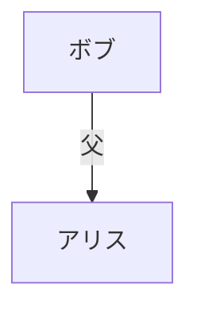

# siori（小説のしおり）Android アプリ 設計仕様

## 目的

翻訳小説の巻頭に付く人物紹介や、紙の本に挟む人物紹介のしおりをスマホに持ち込む。
読書中の「この人物は誰だったか」「誰とどういう関係か」を、作品ごとの登場人物紹介と関係図で手早く解消する。
紙の本・電子書籍のどちらでも使える、独立したオフラインアプリとする。

## スコープ

### 初版に含む

1. 同梱カタログから作品を選ぶ。
2. 人物一覧と短い説明を読む。
3. 人物名・別名で検索する。
4. 作品の関係図を表示し、拡大・縮小・移動する。
5. 通信なしで上記の操作ができる。

### 初版に含まない（将来候補）

- アプリ内での作成・編集。
- JSON / Mermaid のインポート・エクスポート。
- 利用者メモ、読書位置の保存。
- 章ごとの表示切り替えや複雑なネタバレ制御。
- 関係図の人物ノードをタップして人物紹介を開く連携（描画方式依存のため設計上フックのみ）。
- ログイン、サーバー、同期、読書アプリとの連携。
- DB。人物・関係図の管理は同梱アセットのみで行う。

## 確定事項

| 項目 | 決定 |
| --- | --- |
| 対象 | Android アプリ |
| 利用・配布 | 個人利用、APK サイドロード（Play 公開は考慮しない） |
| UI 技術 | Jetpack Compose + Material 3 |
| アーキテクチャ | 単一モジュール `:app`、`data` / `ui` パッケージ分離 |
| 人物情報 | JSON で保持（同梱） |
| 関係図 | Mermaid テキストで保持（同梱） |
| 紐付け | 作品ID（カタログ・ディレクトリ名・`characters.json.workId` で一致） |
| Mermaid 描画 | 実行時描画（WebView + 同梱 mermaid.js） |
| 人物詳細画面 | 初版では独立画面にしない（一覧行の展開で表示） |
| DB | 使用しない |

## プロジェクト構成

### ビルド・環境

- Gradle Kotlin DSL + Version Catalog（`gradle/libs.versions.toml`）。
- Kotlin / Java / Gradle は mise 管理。
- `applicationId = com.example.siori`（暫定。変更可能）。
- `minSdk = 26` / `targetSdk = 35` / `compileSdk = 35`。
  - WebView と `WebViewAssetLoader` の安定動作、および個人端末のカバレッジを優先。

### モジュール・パッケージ

単一モジュール `:app`。主なパッケージ:

```
com.example.siori
  data          # モデル、Repository、アセット読み込み・検証
  ui            # 画面、ViewModel、ナビゲーション
  ui.theme      # Material 3 テーマ
```

### アセット構成

作品IDをディレクトリ名として使用し、ファイル対応を単純にする。

```
app/src/main/assets/
  catalog.json
  works/
    <workId>/
      characters.json
      relations.mmd
  mermaid/
    mermaid.min.js     # 同梱。外部 CDN に依存しない
    viewer.html        # 描画ホストページ
```

## データモデル

kotlinx.serialization で表現する。

### 作品カタログ `catalog.json`

```json
{
  "schemaVersion": 1,
  "works": [
    { "id": "sample-novel", "title": "作品名", "author": "著者名" }
  ]
}
```

- `Work(id, title, author)`

### 人物情報 `works/<workId>/characters.json`

```json
{
  "schemaVersion": 1,
  "workId": "sample-novel",
  "characters": [
    {
      "id": "alice",
      "name": "アリス",
      "aliases": ["アリス嬢"],
      "description": "港町で暮らす主人公。"
    }
  ]
}
```

- `Character(id, name, aliases: List<String>, description)`

### 関係図 `works/<workId>/relations.mmd`

Mermaid テキストをそのまま保持する。



### ID 規約

- 作品ID・人物IDは表示名から独立した安定した識別子とする。
- 人物IDは作品内で一意。Mermaid の人物ノードIDを JSON の人物IDに一致させる。
- 関係図に全人物を載せる必要はない。人物一覧にあり図に無い人物を許容する。
- 家系・組織などの補助ノードを許可する。人物ノードと区別するため、補助ノードIDは `aux:` プレフィックスを必須とする。
- `schemaVersion` は現行 `1` とし、モデル変更時に上げる。

## Repository

`SioriRepository` インターフェース（アセット読み込みは IO のため `suspend`）:

- `suspend fun loadCatalog(): List<Work>`
- `suspend fun loadCharacters(workId: String): List<Character>`
- `suspend fun loadRelations(workId: String): String`

同梱アセットを読むだけ。状態を持たず、DB を使わない。実装は `data` パッケージに置く。

## データ検証

「実装時の確認事項」を JVM 単体テストとして固定し、ビルド時に壊れた同梱データを検出する。
データの正本は `app/src/main/assets` のまま。テストは `File("src/main/assets")`（Gradle 単体テストの作業ディレクトリはモジュール直下）を読む。

検証項目:

- `catalog.json` の作品IDに重複がない。
- カタログの各作品IDに対応するディレクトリが存在し、`characters.json` と `relations.mmd` を両方含む。
- カタログに無い余剰ディレクトリが無い。
- `characters.json` の `schemaVersion` が `catalog.json` と一致する。
- `characters.json` の `workId` がディレクトリ名と一致する。
- 作品内で人物IDが一意である。
- Mermaid のノードIDが人物IDに解決できる。`aux:` プレフィックスの補助ノードは例外として許容する。
- すべての JSON がパースできる。

Mermaid の構文妥当性・日本語ラベルの描画は、単体テストでは保証しづらいため、少数のサンプル作品で WebView 描画を手動確認する（必要なら instrumented テストを追加）。

## 画面構成・ナビゲーション

`navigation-compose` の3ルート。

| ルート | 画面 | 内容 |
| --- | --- | --- |
| `works` | 作品一覧 | タイトル・著者を表示し、作品を選ぶ。起動画面 |
| `works/{workId}/characters` | 人物一覧 | 名前と短い説明。名前検索を提供 |
| `works/{workId}/relations` | 関係図 | Mermaid を描画。拡大・縮小・移動 |

### 人物詳細の扱い

初版は独立画面にしない。項目は「名前・別名／愛称・短い概要」のみで情報量が少ないため、人物一覧の行タップで行内展開（expandable list item）し、別名と概要を表示する。将来情報量が増えた場合に詳細ルートへ昇格できる。

### 往復導線

スマホでは人物一覧を基本の入口とし、関係図は補助として扱う。

- 人物一覧のアプリバーに関係図へのアクションを置く。
- 関係図画面に人物一覧へ戻るアクションを置く。
- 双方1タップで往復できること。
- 関係図の WebView 状態はナビゲーションのバックスタックで保持する。

### 検索

- 空でないクエリで `name` と `aliases` を対象に部分一致する。
- 比較前に正規化する: 大小文字、全角/半角、ひらがな/カタカナの折り畳み。翻訳小説で同じ人物の呼び方が変わる場合に役立てる。
- 姓・愛称は `aliases` に格納する運用とする。
- 0件時は空状態を表示する。

## Mermaid 描画（WebView）

### 方式

実行時に WebView 内で mermaid.js が Mermaid テキストを SVG に描画する。

- `mermaid.min.js` と `viewer.html` を `assets/mermaid/` に同梱し、外部 CDN へ接続しない。
- `viewer.html` は `startOnLoad:false` で初期化し、`window.renderDiagram(text)` を公開する。
- WebView は `WebViewAssetLoader`（androidx.webkit）で `https://appassets.androidplatform.net/` 経由でアセットを配信し、`file://` の制約を避ける。
- 図テキストは `evaluateJavascript("window.renderDiagram(" + JSONObject.quote(mmd) + ")")` で注入する。

### 拡大・縮小・移動

- WebView のピンチズームを有効化する（`setSupportZoom(true)` / `builtInZoomControls = true` / `displayZoomControls = false`）。
- SVG は `max-width: none` で自然サイズ描画し、ページ全体をパン可能にする。
- 初版はこれで拡大・縮小・移動の要件を満たす。

### セキュリティ・オフライン

- ネットワーク通信を必須にしない。
- `shouldOverrideUrlLoading` でアセット以外への遷移をブロックする。
- cleartext 通信を無効化する。
- ファイルアクセスを無効化し、アセットローダ経由に限定する。

### 将来フック

ノードタップで `@JavascriptInterface` 経由で人物IDを親へ返す口を設計上残す。初版では実装しない。

## エラーハンドリング

- `SioriRepository` は typed 例外（`AssetMissingException` / `AssetParseException`）を投げる。
- ViewModel は `UiState = Loading | Success | Error` を公開する。
- 同梱データは単体テストで保証されるため実質ビルド時保証。実行時に万一壊れていてもクラッシュさせず、エラー画面を表示し該当作品のみ無効化する。
- 検索0件は空状態、Mermaid 描画失敗はエラー表示と再試行を提供する。

## 依存ライブラリ

- Compose BOM / Material 3
- navigation-compose
- lifecycle-viewmodel-compose
- kotlinx-serialization-json
- androidx.webkit（WebViewAssetLoader）

## テスト

- JVM 単体テスト: JSON パース、上記のアセット検証項目すべて、検索マッチング（正規化含む）。
- Compose UI テスト: 作品一覧→人物一覧→関係図の画面遷移スモーク（任意）。
- 手動確認: 日本語ラベルの関係図がオフラインで表示・ピンチ操作できること。少数のサンプル作品で確認する。

## 実装順序の要点

1. 少数のサンプル作品（`sample-novel` など）で閲覧体験を成立させる。
2. アセット検証テストを先に用意し、同梱データの整合性を担保する。
3. WebView の日本語描画と操作感を小さなサンプルで確認してから画面を作り込む。
4. 章別ネタバレ制御、DB、アプリ内編集などを前提に設計を広げない。
